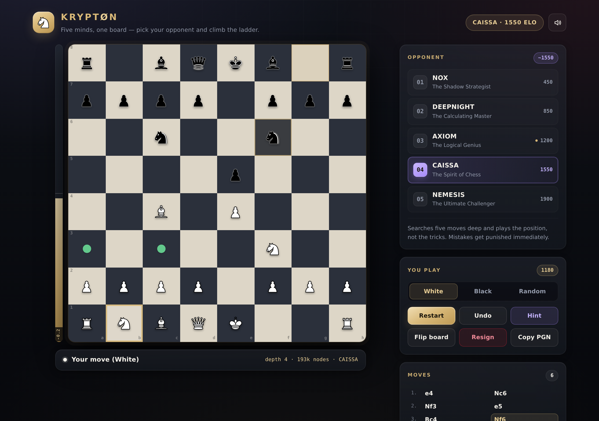
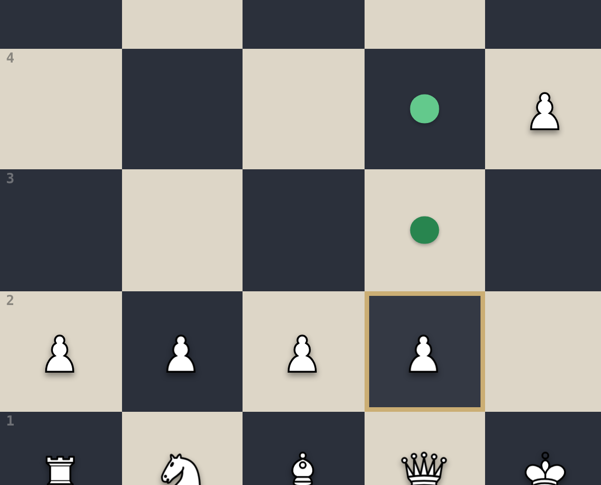
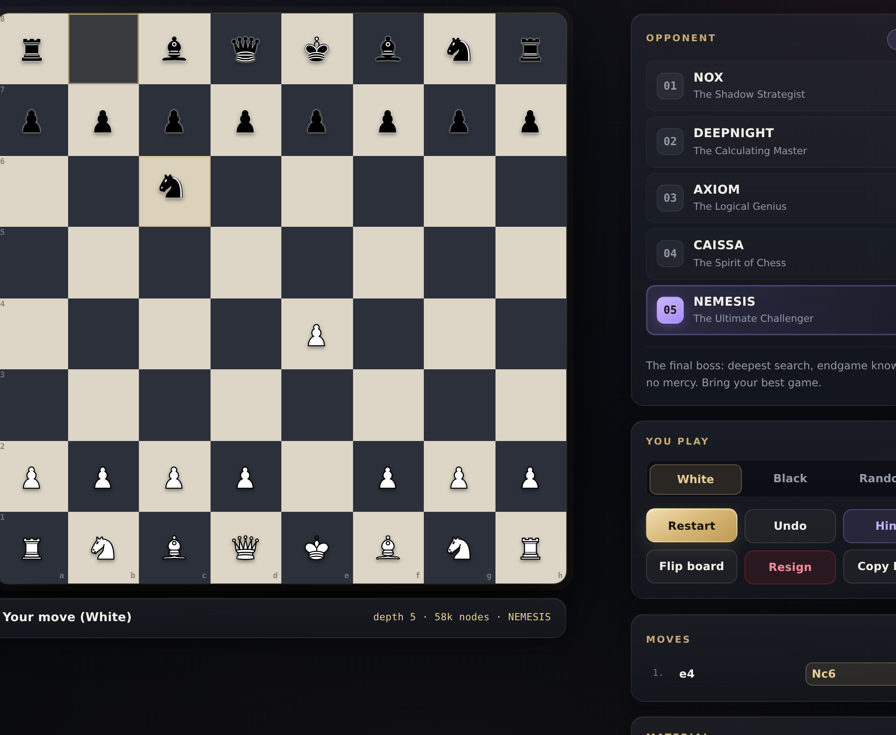
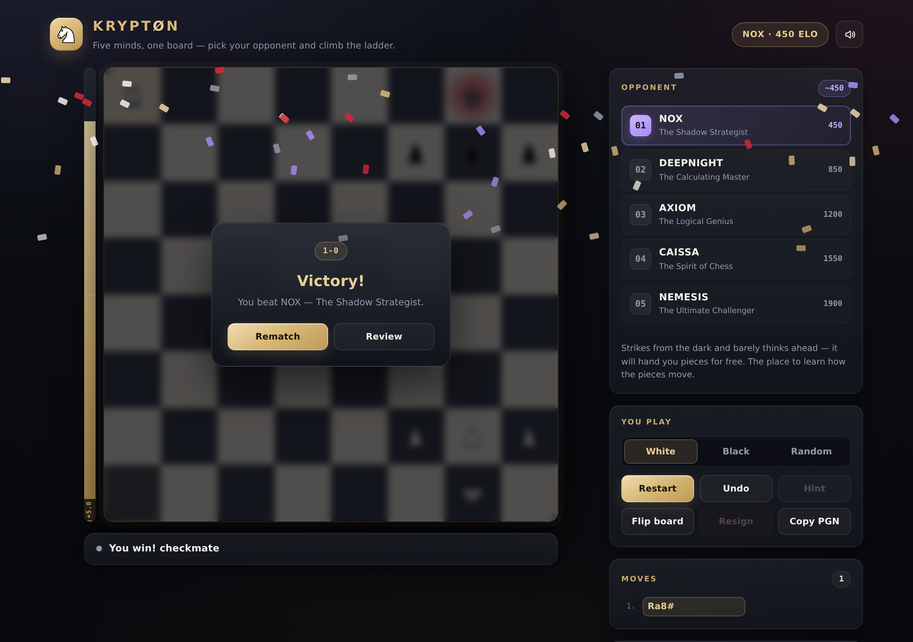
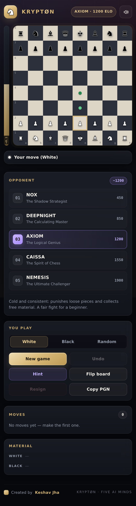

<div align="center">


# KRYPTØN — Free AI Chess Game You Can Play Online

**Play chess against five AI opponents in your browser. No sign-up, no install, no engine to configure.**

[](https://keshav-cmd.github.io/KRYPTON/)
[](https://github.com/Keshav-cmd/KRYPTON/raw/refs/heads/main/app/KRYPT%C3%98N.apk)
[](js/)
[](#how-the-engine-thinks)

[**Play now**](https://keshav-cmd.github.io/KRYPTON/) · [Download the APK](https://github.com/Keshav-cmd/KRYPTON/raw/refs/heads/main/app/KRYPT%C3%98N.apk) · [Screenshots](#screenshots) · [How it works](#how-the-engine-thinks)

</div>

---

**KRYPTØN** is a free, open-source **AI chess game** that runs entirely in your browser. It pits you against five distinct **chess engines** — from a beginner-friendly strategist at ~450 Elo to a full-strength 7-ply searcher at ~1900 Elo — on a single page of HTML, CSS and JavaScript. There is no backend, no account, no analytics and nothing to install: every move is calculated on your own device, which means it also works **offline**.

The project is a from-scratch chess engine — move generation, alpha-beta search, evaluation and all — with a UI built around it in the **Obsidian Edition** design system (void black, titanium, champagne gold).

## Table of contents

- [Play online](#play-online)
- [Screenshots](#screenshots)
- [The five AI opponents](#the-five-ai-opponents)
- [Features](#features)
- [How the engine thinks](#how-the-engine-thinks)
- [Colour system — Obsidian Edition](#colour-system--obsidian-edition)
- [Download & install](#download--install)
- [Controls & keyboard shortcuts](#controls--keyboard-shortcuts)
- [URL parameters](#url-parameters)
- [Project structure](#project-structure)
- [FAQ](#faq)
- [Credits](#credits)

## Play online

**[keshav-cmd.github.io/KRYPTON](https://keshav-cmd.github.io/KRYPTON/)** — works in any modern desktop or mobile browser, installs to nothing, and needs no account. Pick an opponent, choose White or Black, and start playing.

Prefer an app icon on your home screen? Grab the Android build: **[`app/KRYPTØN.apk`](https://github.com/Keshav-cmd/KRYPTON/raw/refs/heads/main/app/KRYPT%C3%98N.apk)**.

## Screenshots

| Desktop — playing CAISSA | Board detail — selection, legal moves, last move |
| :---: | :---: |
|  |  |

| Engine thinking & hint | Victory screen | Mobile layout |
| :---: | :---: | :---: |
|  |  |  |

## The five AI opponents

Five fixed personalities, each with its own search budget and mistake rate — a deliberate difficulty ladder rather than a slider.

| #  | Bot            | Title                     | Elo   | How it plays                                    |
| -- | -------------- | ------------------------- | ----- | ----------------------------------------------- |
| 01 | **NOX**        | The Shadow Strategist     | ~450  | depth 1, 50 % random moves                      |
| 02 | **DEEPNIGHT**  | The Calculating Master    | ~850  | depth 2, 22 % random moves                      |
| 03 | **AXIOM**      | The Logical Genius        | ~1200 | depth 3 with quiescence search                  |
| 04 | **CAISSA**     | The Spirit of Chess       | ~1550 | depth 5, null-move pruning                      |
| 05 | **NEMESIS**    | The Ultimate Challenger   | ~1900 | depth 7, full search                            |

Press `1`–`5` to jump between them mid-session.

## Features

- **Play chess against AI** by clicking or dragging — castling, en passant, under-promotion and the promotion picker all work
- **Full rule set**: check, checkmate, stalemate, threefold repetition, fifty-move rule and insufficient material are all detected
- **Legal-move highlighting** in green, gold selection and a restrained gold last-move overlay — pieces stay legible on both square colours
- **Evaluation bar** plus a live engine read-out (search depth and nodes searched) for every move
- **Hints** from a full-strength search when you get stuck, and single-click **undo** that takes back a whole round
- **Play as White, Black or random**; the board auto-orients and can be flipped at any time
- **Move list** with click-to-review any earlier position, then jump back to the live game
- **PGN export** to the clipboard, captured-material panel, synthesized sound effects
- **Responsive** down to small phones, with visible keyboard focus rings and `prefers-reduced-motion` support
- **Offline and private**: no network calls, no tracking, no accounts

## How the engine thinks

The engine is written from scratch in `js/engine.js` and `js/ai.js` — no Stockfish, no WASM blobs, no dependencies.

| Layer | Implementation |
| ----- | -------------- |
| Board | 0×88 mailbox representation, incremental zobrist hashing |
| Move generation | Fully legal generation — pins, checks, castling rights, en passant |
| Search | Alpha-beta with iterative deepening, transposition table, killer moves, history heuristic, MVV-LVA ordering |
| Quiescence | Capture-only search at the horizon to avoid the horizon effect |
| Pruning | Null-move pruning at the higher tiers |
| Evaluation | Material, piece-square tables, king safety, pawn structure, mobility |
| Scheduling | The root search yields to the browser between moves, so the page never freezes while a bot thinks |

Correctness is checked against known references rather than by feel: the starting position returns **20** legal moves, **perft(3) = 8,902**, and Kiwipete at depth 2 returns **2,039** — the standard values for a correct move generator.

## Colour system — Obsidian Edition

Deep black, titanium panels, one champagne accent. Colour is earned, not sprayed: gold marks the brand and the engine's voice, crimson is reserved for the things that end a game, violet belongs to the AI, green means "this move is legal".

| Token        | Hex       | Name            | Role                                                                  |
| ------------ | --------- | --------------- | --------------------------------------------------------------------- |
| `--void`     | `#0B0D12` | Void Black      | page background, ~50 % of the surface                                 |
| `--titanium` | `#191D26` | Titanium        | panels and cards (~25 % together with graphite)                       |
| `--graphite` | `#292D37` | Graphite        | elevated surfaces, dark board squares, active rows                    |
| `--gold`     | `#D8B878` | Champagne Gold  | primary buttons, wordmark, eval bar, engine read-outs (~12 %)         |
| `--crimson`  | `#D72638` | Crimson Red     | resign, alerts, check, defeat (~8 %)                                  |
| `--violet`   | `#A78BFA` | Electric Violet | AI surfaces: opponent picker, thinking state, hints (~5 %)            |
| `--steel`    | `#9299A9` | Steel Grey      | secondary text, labels, metadata                                      |
| `--cloud`    | `#F4F1EA` | Cloud White     | primary text, bone board squares                                      |

Derived tokens keep the board and feedback states on the same palette: `--sq-light #DDD6C7`, `--sq-dark #2B303B`, `--legal #28854F` (move dots) / `--legal-strong #63C98C` (on dark squares), `--gold-text #E7CD95`, `--violet-text #C3B2FC`, `--crimson-text #F08A98`, plus a gold ramp (`--gold-50` … `--gold-550`) and RGB triplets so translucent layers are mixed from the same values.

Every colour in `styles.css` resolves from the `:root` token block — a scan finds no stray hex or `rgba()` literal elsewhere in the stylesheet. All text pairs clear WCAG AA (Cloud/Void 17.2:1, Cloud/Graphite 12.2:1, Gold/Titanium 8.9:1, Violet-text/Titanium 8.9:1, Steel/Titanium 5.9:1) and the legal-move dots clear 3:1 on both board colours.

## Download & install

### Play in the browser

Open **[keshav-cmd.github.io/KRYPTON](https://keshav-cmd.github.io/KRYPTON/)** — nothing else required.

### Android APK

Download **[`app/KRYPTØN.apk`](https://github.com/Keshav-cmd/KRYPTON/raw/refs/heads/main/app/KRYPT%C3%98N.apk)** and open it on your phone. Android will ask for permission to install from your browser or file manager the first time (*Settings → Install unknown apps*). The same build works offline.

> The repository stores the APK at `app/KRYPTØN.apk`. Because the filename contains `Ø`, links use the percent-encoded path `https://github.com/Keshav-cmd/KRYPTON/raw/refs/heads/main/app/KRYPT%C3%98N.apk`.

### Run it locally

```bash
git clone https://github.com/keshav-cmd/KRYPTON.git
cd KRYPTON
python3 -m http.server 8000
# then open http://localhost:8000
```

There is no build step and there is no `npm install` — `index.html` opens directly from disk too, which is also why the game works offline.

## Controls & keyboard shortcuts

| Key | Action |
| --- | ------ |
| `1`–`5` | Pick an opponent (NOX → NEMESIS) |
| `N` | New game |
| `U` | Undo a full round |
| `H` | Hint from the engine |
| `F` | Flip the board |
| `Esc` | Clear the current selection |

Click your piece, click the destination — or drag and drop. Click any move in the move list to review the position, then *Back to live*.

## URL parameters

Handy for demos, testing and sharing a position:

```text
?level=<id|name>&color=<w|b>&fen=<FEN>
```

- `level` accepts the internal id (`novice`, `casual`, `club`, `expert`, `master`) or the bot's name (`NOX`, `DEEPNIGHT`, `AXIOM`, `CAISSA`, `NEMESIS`)
- `color` accepts `w` or `b` (or `white` / `black`)
- `fen` loads any position, so you can share a puzzle or analyse a specific game

Example: `index.html?level=nemesis&color=b&fen=6k1/5ppp/8/8/8/8/5PPP/R5K1 w - - 0 1`

## Project structure

```text
KRYPTON/
├── index.html              # app shell — board, opponent ladder, panels, modals
├── styles.css              # Obsidian Edition design system (all colours are tokens)
├── js/
│   ├── engine.js           # board, move generation, make/unmake, SAN, FEN, game state
│   ├── ai.js               # evaluation, search, the five difficulty tiers
│   └── app.js              # rendering, input, game flow, modals, sound
├── assets/
│   ├── pieces/             # SVG chess piece set
│   ├── poster.png          # this README's hero image
│   └── poster-art.png      # the un-typeset poster artwork
├── screenshots/            # reference renders used above
└── app/
    └── KRYPTØN.apk         # Android build
```

## FAQ

**Is KRYPTØN free?**
Yes. The whole game is free to play in the browser or as an APK, with no ads, accounts or paywalls.

**Do I need to install anything to play online?**
No. It is a static site — HTML, CSS and JavaScript only — so it runs in any modern browser and even loads straight from the filesystem.

**Does it work offline?**
Yes. Once the page is loaded (or the APK is installed) the engine runs locally on your device, so no internet connection is required to play.

**Can I play as Black?**
Yes — choose Black before you start, use *Random*, or flip the board with `F` at any time.

**Is it as strong as Stockfish?**
No, and it does not try to be. KRYPTØN is a compact, readable engine tuned to a human-relevant range, from ~450 Elo for beginners to ~1900 Elo for experienced club players.

**Which is the hardest opponent?**
NEMESIS at ~1900 Elo — full 7-ply search with null-move pruning. CAISSA (~1550) is the usual tipping point for improving players.

**How do I take back a move?**
Press `U` or hit **Undo**: it takes back your move and the engine's reply together, so it is always your turn again.

**Can I copy the game as PGN?**
Yes — **Copy PGN** puts the full game on your clipboard, ready to paste into a database or share.

## Credits

Designed and built by **Keshav Jha**.

- Live site: [keshav-cmd.github.io/KRYPTON](https://keshav-cmd.github.io/KRYPTON/)
- Source: [github.com/keshav-cmd/KRYPTON](https://github.com/keshav-cmd/KRYPTON)

If you play a game and enjoy it, a ⭐ on the repository genuinely helps other people find it.

---

<div align="center">
<sub>KRYPTØN · Obsidian Edition · chess engine written from scratch in JavaScript</sub>
</div>
